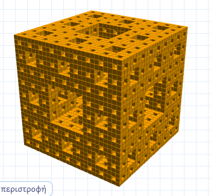

# Fractal Lab · Menger Sponge

**[▶ Open the live lab](https://izzydi.github.io/menger-sponge/)**

An interactive maths and Python lab for Greek lower-secondary (Gymnasium) students, designed for a single lesson. It follows on from [the Koch snowflake lab](https://izzydi.github.io/koch-fractal/): students read a commented Python program that builds the Menger sponge, change the level and colour, run the code in the browser and turn the result around in 3D. No installation or account is needed.

## What students do

- Follow Karl Menger's 1926 construction: split a cube into 3 × 3 × 3 = 27 smaller cubes, remove the centre and the 6 face centres, and repeat on the 20 that remain.
- Work through the maths: dividing the edge by 3, why 27 − 7 = 20, the cube counts 1, 20, 400, 8,000, and the volume fractions 20/27, 400/729, 8,000/19,683.
- Edit `LEVEL` and `COLOR` in a syntax-highlighted editor and run real Python 3, or move the slider to preview levels 0–3 instantly.
- Rotate the sponge by dragging, with the arrow keys, or let it turn on its own.

## How it works

- One self-contained [`index.html`](index.html), published with GitHub Pages.
- The lesson figures are isometric SVG drawings generated in the page; the 3D view uses [three.js](https://threejs.org/) with one instanced mesh, so 8,000 cubes stay smooth on school laptops.
- Edited code runs in [Pyodide](https://pyodide.org/), loaded on the first run, so running Python needs an internet connection.
- The page checks the Python output before drawing it: at most 8,000 cubes, each as `(x, y, z, size)`, and a named colour.

## Στα ελληνικά

Εκπαιδευτικό εργαστήριο Python για το Γυμνάσιο, για μία διδακτική ώρα και συνέχεια της χιονονιφάδας Koch. Οι μαθητές χτίζουν το σφουγγάρι Menger, υπολογίζουν κυβάκια και όγκο με κλάσματα και τρέχουν Python απευθείας στον browser, με τρισδιάστατη προβολή που περιστρέφεται.
